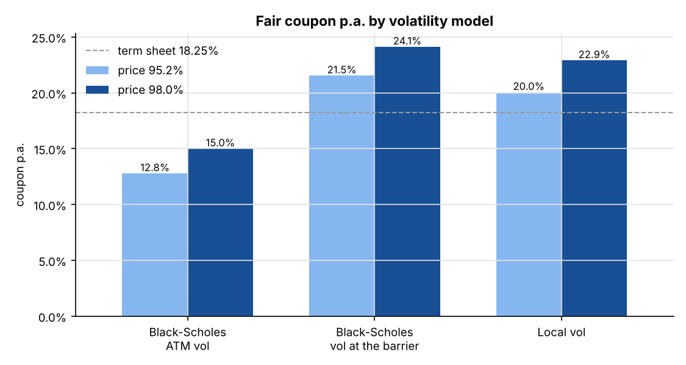
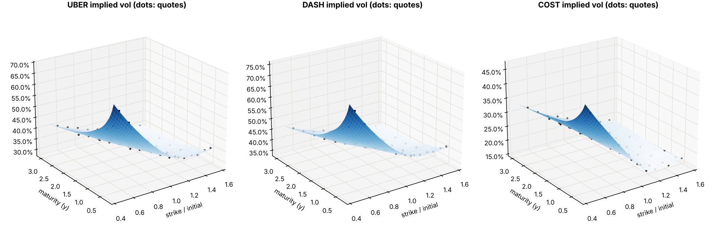
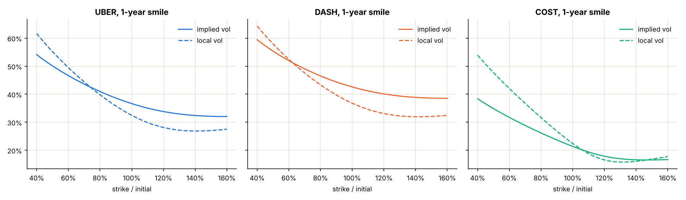
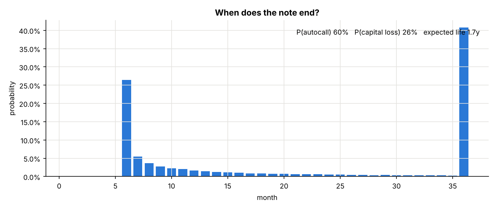
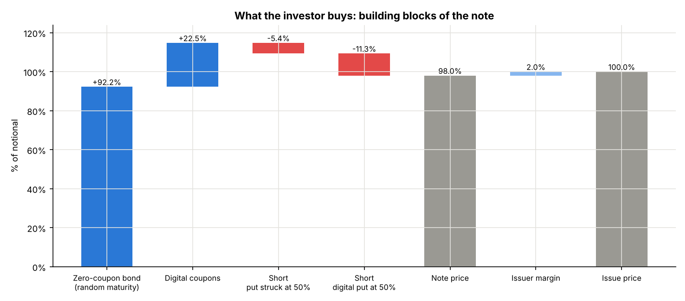
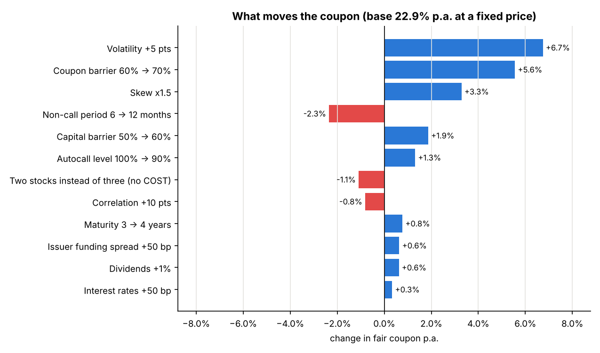
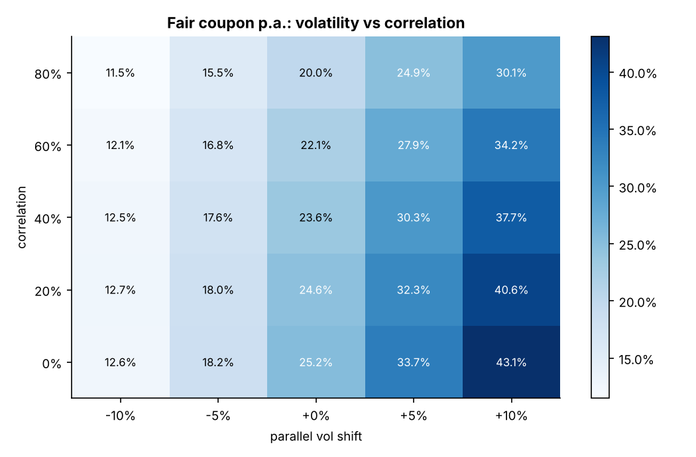
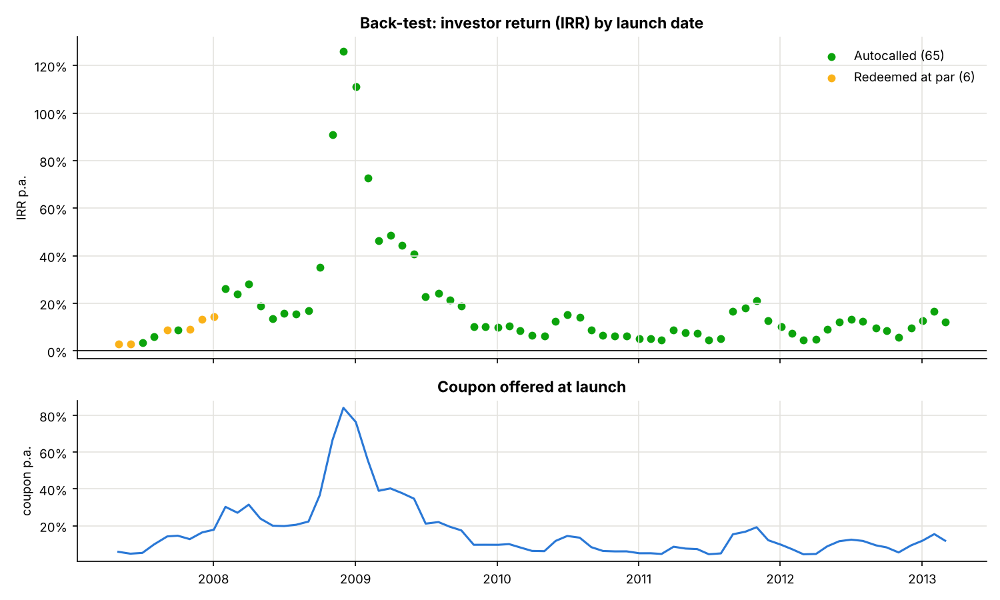
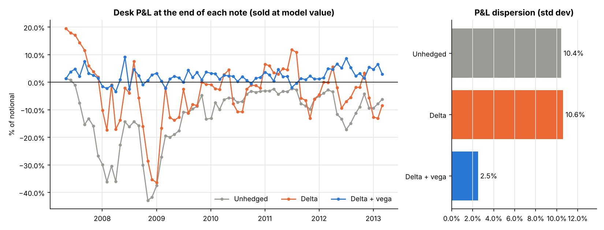

# Worst-of Phoenix Autocall: Pricing and Structuring

A Monte Carlo pricer for a worst-of Phoenix autocallable under Dupire local volatility.
It solves the coupon for a target price, splits the note into building blocks, shows what
moves the coupon, computes the desk's Greeks and back-tests both the note and its
delta/vega hedge on historical prices.

The reference product is a real note: Barclays' **Phoenix AutoCallable Notes due 2028 on
UBER / DASH / COST** ([pricing supplement, SEC](https://www.sec.gov/Archives/edgar/data/312070/000191870425019388/form424b2.htm)).



*At Barclays' estimated value (95.2%), local vol gives a fair coupon of 20.0% p.a., against
18.25% on the term sheet. Black-Scholes with the ATM vol ignores the skew and would offer only
12.8%: the investor is short a put struck at 50%, so the vol that matters is the one at the barrier.*

## The product

| Term | Barclays note (CUSIP 06746EPG4) |
|---|---|
| Underlyings | Uber, DoorDash, Costco (worst-of) |
| Maturity | 3 years, monthly observations |
| Coupon | 18.25% p.a., paid each month if the worst stock is ≥ 60% of its initial level |
| Autocall | From month 6, repaid at 100% if every stock is ≥ its initial level |
| Capital | At maturity, below 50% the investor gets the worst performance |
| Issue price | 100%, Barclays' estimated value 95.2% |

## Code

```
autocall/
  product.py      the note's terms and its payoff on simulated or historical paths
  vol_surface.py  SSVI implied vol surface, calibration to quotes, Dupire local vol
  market.py       spots, rates, funding, dividends, correlation; stylised UBER/DASH/COST market
  monte_carlo.py  correlated Monte Carlo under local vol
  pricer.py       price, coupon solver, probabilities, building blocks
  risks.py        coupon levers and the desk's Greeks (bump-and-revalue)
  backtest.py     the note launched every month on real prices: coupon offered, investor IRR
  hedging.py      the desk's delta and delta/vega hedge, back-tested on the same launches
  plots.py        charts
run_analysis.py   runs everything and saves the charts and tables in results/
tests/            pytest
```

```bash
pip install -r requirements.txt
python run_analysis.py          # about 7 minutes; --quick for a fast check
python -m pytest -q             # 10 tests
```

```python
from autocall import Phoenix, Pricing, reference_market

pricing = Pricing(Phoenix(), reference_market())
print(pricing.summary())             # price, P(autocall), P(capital loss), expected life
print(pricing.solve_coupon(0.98))    # fair coupon for a price of 98%
```

## Method

**Vol surface.** Each stock gets an SSVI surface (Gatheral & Jacquier, 2014), calibrated by
least squares to implied vol quotes. There is no market data feed here, so the quotes are
generated from stylised surfaces plus noise, then calibrated as real quotes would be.



**Local vol.** Dupire's formula, written in total variance `w(k, T)` (Gatheral):

```
sigma_loc^2 = (dw/dT) / g,   g = (1 - k w'/(2w))^2 - w'^2/4 (1/w + 1/4) + w''/2
```

The local skew is steeper than the implied skew, which matters for a note that is short a
put far out of the money.



**Monte Carlo.** The three stocks are simulated with correlated Brownian motions (Cholesky)
and their local vols, 4 steps per month, 100,000 paths with antithetic variates.
Cash flows are discounted at the risk-free rate plus Barclays' funding spread
(3.7% + 1.0%): the issuer's funding is part of what pays the coupon.

**Coupon solver.** On fixed paths the price is linear in the coupon: `price(c) = A + c * B`,
with `A` the value of the principal and `B` the value of a 100% coupon. So the fair coupon
`c = (target - A) / B` comes out exactly from a single simulation.

## Results

### Pricing

| | |
|---|---|
| Price at the term sheet coupon (18.25%) | 93.4% ± 0.2% |
| Fair coupon for a price of 98% | 22.9% p.a. |
| P(autocall) / P(capital loss) | 60% / 26% |
| Expected life | 1.75 years |

The model price is 1.8 points below Barclays' estimate: the market inputs are stylised
assumptions, not the quotes of the pricing date.



### Building blocks



At a price of 98% (coupon 22.9%), the investor owns a zero-coupon bond repaid at the call or
maturity date (92.2%) and a strip of digital coupons (22.5%). The investor has sold a
down-and-in put on the worst stock (-16.7%). With a barrier observed only at maturity, that
put is exactly a **put struck at 50% (-5.4%) plus a digital put paying 50% (-11.3%)**: two
thirds of its value is the gap at the barrier. The remaining 2% is the issuer's margin.

### What moves the coupon



Each bar re-solves the coupon at 98% after one change, with the same random numbers. The
investor is short the put, so anything that makes it more expensive raises the coupon:
volatility (+6.7 pts for +5 vol pts), skew, a higher capital barrier. Anything that makes the
investor more likely to be paid lowers it: a longer non-call period (-2.3 pts) or fewer
stocks. Higher correlation lowers the coupon, and more so when vol is high: 13 points between
0% and 80% correlation at +10 vol points, about 1 point at -10.



### Greeks of the desk

The issuer is short the note. Bump-and-revalue sensitivities at the fair coupon
(`results/greeks.csv`):

| Risk | Desk position |
|---|---|
| Delta | short UBER (-7.9% of notional) and DASH (-14.6%), slightly long COST |
| Vega | **long vol**: +1.26% of notional per vol point on all stocks |
| Correlation | loses 7 bp per correlation point when correlation rises |
| Dividends | long dividends: gains 6 bp per +10 bp of dividend yield |

Correlation and dividends cannot be hedged with listed options: they are the classic
residual risks of a worst-of book.

### Historical back-test



The note is launched on the first trading day of each month on AAPL, MSFT and SBUX. The
coupon is re-solved at 98% with the past three months' realised vols and correlations, then
the real prices decide the outcome. Over 71 launches (May 2007 to March 2013), 92% were
autocalled and 8% repaid at par, with no capital loss and a mean IRR of 18.7%. The coupon
offered follows vol, from 4% in quiet markets to 84% at the end of 2008.

The sample is short and kind: three large caps that recovered from 2008 within three years.

### Hedging the note



On the same launches, the desk sells the note at its model value and hedges it every week
until it ends. At each date the remaining note is re-priced with that day's prices and vols,
and its Greeks are computed by bump-and-revalue:
- **delta hedge**: hold dV/dS of each stock;
- **delta + vega hedge**: also sell 1-year at-the-money calls on each stock so that the book
  has no vega, then delta-hedge everything.

| Desk P&L at the end, % of notional | Mean | Std dev | Worst |
|---|---|---|---|
| Unhedged | -12.2% | 10.4% | -42.9% |
| Delta hedge | -3.6% | 10.6% | -36.4% |
| Delta + vega hedge | +2.3% | 2.5% | -3.4% |

The delta hedge alone barely reduces the risk, because the desk's main risk is vega. The
desk is long vol: the 2007 launches made up to +19% when vol exploded in 2008, and the late
2008 launches, priced at 65-90% vol with coupons above 60%, lost up to 36% when vol fell.
The vega hedge divides the dispersion by four. What is left comes from gamma, correlation
and weekly rebalancing. No transaction costs.

