# Phoenix Autocall Worst-of: pricing, hedging and P&L explain on Bloomberg data

I take a real structured note, the **Barclays Phoenix AutoCallable note on UBER, DASH and COST (due 2028)**,
and look at it the way a structurer and a trader would:

1. **At launch (7 Nov 2025):** what was the note worth, and is Barclays' estimated value (95.2%) fair?
2. **Today (29 Oct 2026):** what is it worth now, and why did the value move?
3. **In the past:** what would this product have paid on these three stocks?
4. **On the desk:** how does the bank hedge it, and where does its daily P&L come from?

The vol surfaces, forwards and Barclays CDS come from **Bloomberg** (screens OVDV and CDS, on both dates).
Daily stock prices come from Yahoo Finance.

---

## The product in one minute

| Term | Value |
|---|---|
| Underlyings | UBER, DASH, COST (worst-of: only the worst stock matters) |
| Maturity | 3 years, monthly observations (36 dates) |
| Coupon | 18.25% p.a., paid monthly if the worst stock is above **60%** of its initial level (no memory) |
| Autocall | from month 6, if the worst stock is above **100%**: repaid at par + coupon, note stops |
| Capital at maturity | if the worst stock ends below **50%**, the investor loses like the stock (European barrier) |
| Barclays' estimated value | 95.2% of notional |

**The idea:** the investor gets a big coupon because they **sell a put** on the worst of three volatile stocks.
The bank keeps a margin (issue price 100% minus the note's fair value).

---

## How the model works (5 steps)

| Step | What I do | File |
|---|---|---|
| 1. Data | Read the Bloomberg vol quotes (24 expiries, strikes 80% to 120%) and forwards. From the forwards I get the rate and the dividend of each stock, since `F = S·e^((r−q)T)`. | `market.py` |
| 2. Implied vol surface | Fit an **SSVI** surface (Gatheral-Jacquier) to the quotes by least squares, one per stock. | `vol_surface.py` |
| 3. Local vol | Turn the implied surface into a **Dupire local vol** (Gatheral's formula), so the model reprices the whole smile. | `vol_surface.py` |
| 4. Correlation | Bloomberg has no implied correlation for this basket, so I use the **historical correlation** of daily returns over the year before launch. | `market.py` |
| 5. Monte Carlo | Simulate the three stocks together (100,000 paths, weekly steps) and apply the term sheet's rules on each path. Cash flows are discounted at rate + Barclays' CDS spread (the bank's funding). | `monte_carlo.py`, `product.py`, `pricer.py` |

Why local vol and not Black-Scholes? The note depends on the path (monthly autocall) and on the vol **far below spot**
(the 50% barrier). A single flat vol cannot capture the skew.

---

## 1. At launch: is 95.2% fair?

**Calibration.** The SSVI surface fits the Bloomberg quotes within **0.35 / 0.63 / 0.68 vol points** (UBER / DASH / COST).

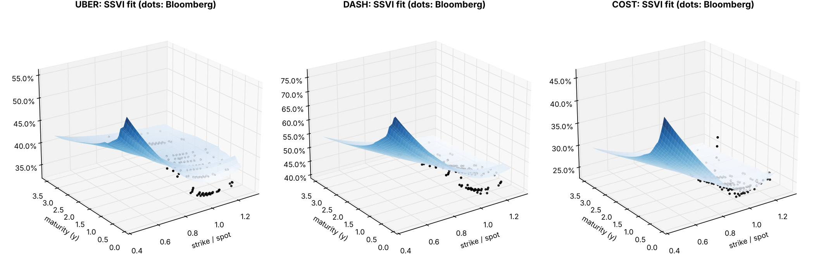
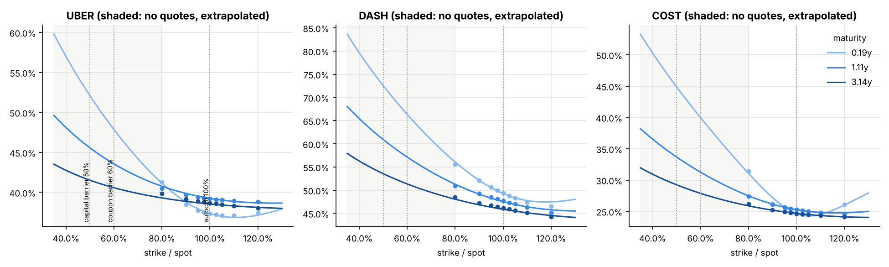

| | UBER | DASH | COST |
|---|---|---|---|
| 3y ATM vol | 38.4% | 45.1% | 24.4% |
| 3y vol at the 50% barrier (extrapolated) | 41.1% | 52.5% | 28.7% |
| Historical correlation | UBER-DASH 0.40 | UBER-COST 0.21 | DASH-COST 0.36 |

**Price.** With the term sheet coupon of 18.25%, my local vol model gives **90.1%** (±0.2%), against **95.2%** for Barclays.
Put differently, at a price of 95.2% the fair coupon would be **23.2%**, not 18.25%.

**Why the gap? It comes from the vol at 50%, which nobody quotes.** Bloomberg only quotes strikes from 80% to 120%,
so the vol at the 50% barrier is an extrapolation. Changing just that changes the answer:

| Model | Price at 18.25% | Fair coupon at 95.2% |
|---|---|---|
| Black-Scholes, ATM vol | 95.3% | 18.2% |
| Black-Scholes, vol at the 50% strike | 88.7% | 24.4% |
| **Local vol (full SSVI smile)** | **90.1%** | **23.2%** |
| Local vol, smile kept flat below 80% | 93.7% | 19.6% |

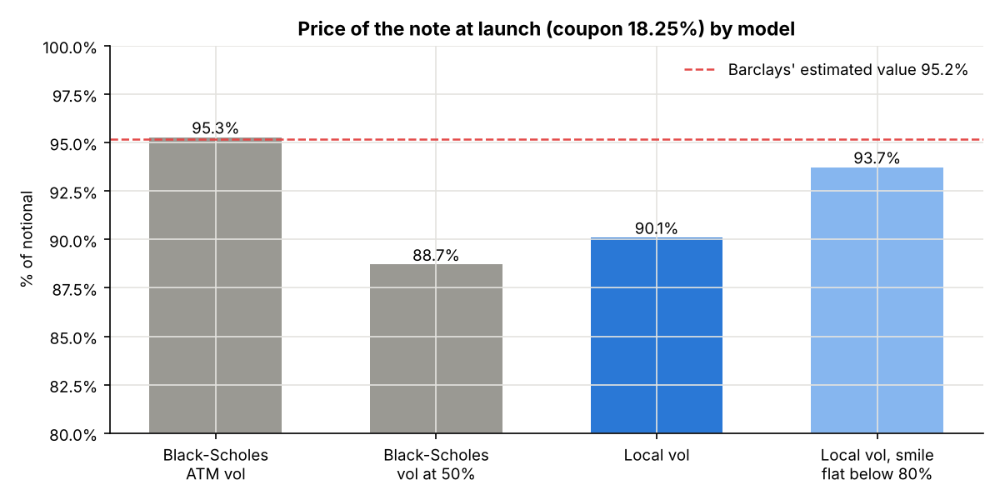

So Barclays' 95.2% is consistent with a **flatter skew below 80%** and/or a **higher correlation**
(+40 pts of correlation alone gives ~94.7%). With the full skew, the note looks expensive for the investor.

**Building blocks.** The note = a zero-coupon bond + monthly digital coupons − a put at 50% − a digital put at 50%:

| Block | Value |
|---|---|
| Zero-coupon bond (random maturity) | 91.9% |
| Digital coupons | +18.7% |
| Short put at 50% | −7.0% |
| Short digital put at 50% | −13.6% |
| **Note price** | **90.1%** |
| Issuer margin (vs 100%) | 9.9% |

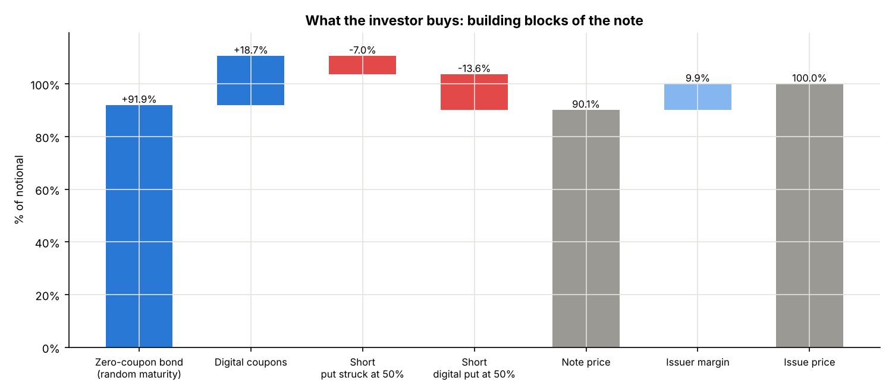

**For the investor at launch:** 53% chance of autocall, 31% chance of losing capital, expected life 1.9 years.

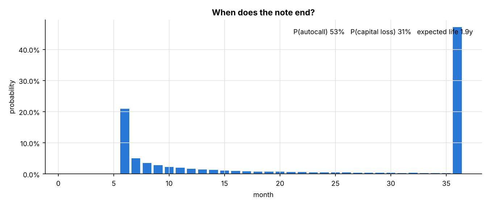

**What drives the coupon?** I re-solve the coupon at 95.2% after moving one input at a time:

| Lever | Coupon change |
|---|---|
| Vol +5 pts | +6.6% |
| Coupon barrier 60% → 70% | +6.1% |
| Capital barrier 50% → 60% | +2.0% |
| Skew x1.5 | +1.4% |
| Correlation +10 pts | −0.8% |
| Non-call period 6 → 12 months | −1.6% |

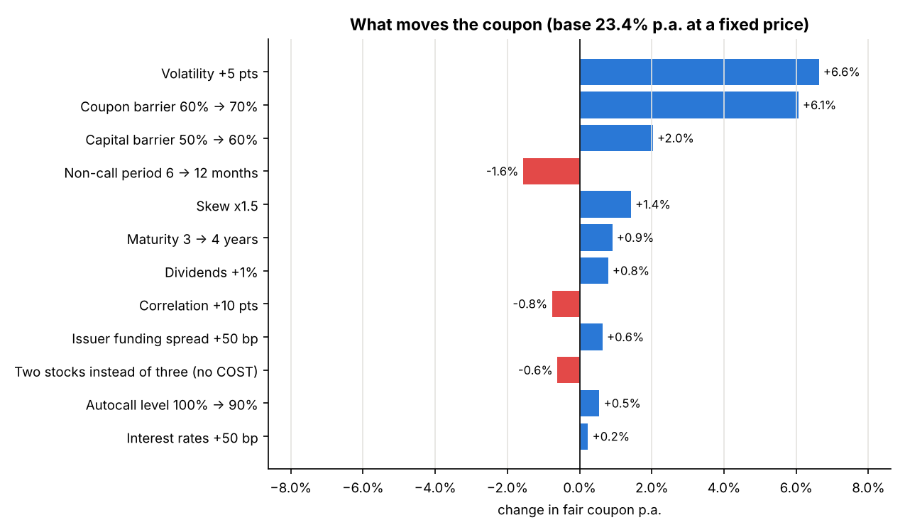

Higher vol and **lower correlation** both mean more risk for the investor, so a bigger coupon.
At +10 vol points, the fair coupon is 41.7% with zero correlation but only 28.0% with 0.8 correlation.

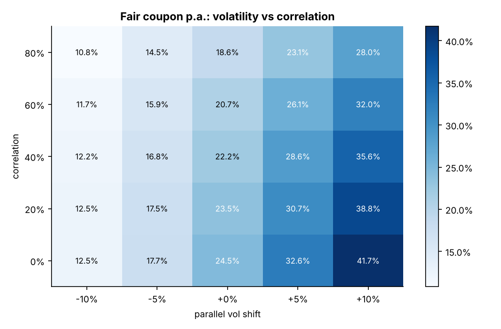

The Dupire local vol is steeper than the implied vol (a classic result: local skew ≈ 2× implied skew):

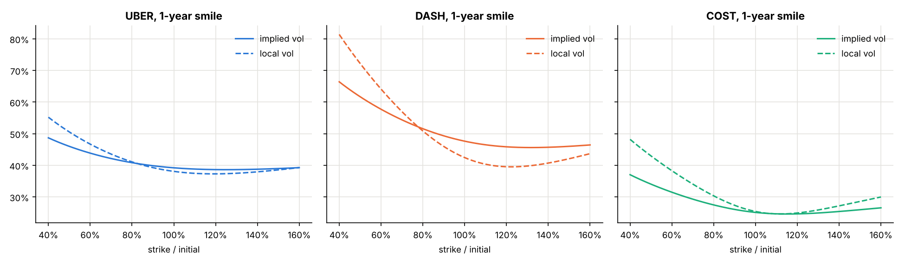

---

## 2. Today: what is the note worth?

**What happened.** Since launch, **11 coupons out of 11** were paid (the worst stock always stayed above 60%),
but **no autocall**: UBER is at 71.5% of its initial level, DASH at 87.6%, COST at 107.9%.
The closest call was on 7 Oct 2026, with the worst stock at 74.4%.

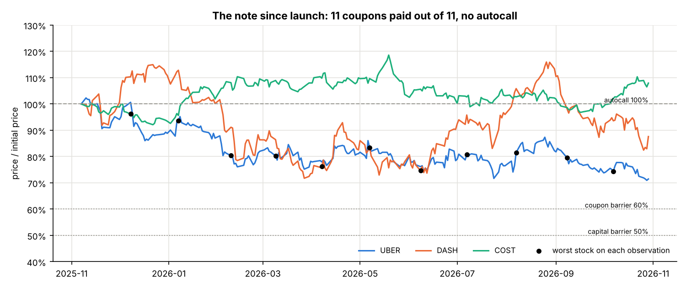

**Value today** (Bloomberg surfaces of 29 Oct 2026, 3y SOFR swap 4.52%, Barclays CDS 74.6 bp):
**82.8%**, plus **16.7%** of coupons already received. Autocall probability 27%, capital loss probability 41%.

**Why did it go from 90.0% to 82.8%?** I replace one input at a time, launch → today:

| Step | Change |
|---|---|
| Value at launch | 90.0% |
| Time passed (one year less of risk) | +4.6% |
| Stock prices (mostly UBER down 28%) | −12.3% |
| Vol surfaces | −0.6% |
| Rates, credit, correlation | +1.2% |
| **Value today** | **82.8%** |

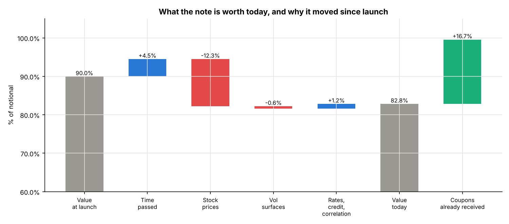

**Desk risks today** (bump-and-revalue). The note is long the stocks and short vol, so the desk
(who sold it) is the opposite:

| Greek of the note | UBER | DASH | COST |
|---|---|---|---|
| Delta | +0.41 | +0.27 | +0.03 |
| Vega (per vol pt) | −0.55% | −0.46% | −0.17% |

Correlation: +0.12% per point (the investor is long correlation). Almost all the risk is on UBER, the worst stock.

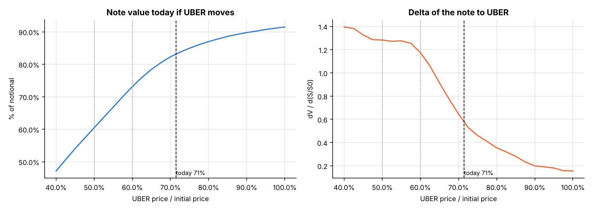

---

## 3. In the past: what would this note have paid?

I launch the same note every month on the real UBER / DASH / COST prices, re-solve the coupon so the price is 95.2%,
and follow what really happened. DASH is only listed since Dec 2020, so there are **32 finished notes** (Apr 2021 to Nov 2023).
For the past I don't have Bloomberg surfaces, so I use **Black-Scholes with the 3-month realised vol** as a proxy.

| Result | |
|---|---|
| Autocalled | 78% (25 notes) |
| Repaid at par at maturity | 22% (7 notes) |
| Capital loss | 0% |
| Average investor IRR | 29.7% p.a. |

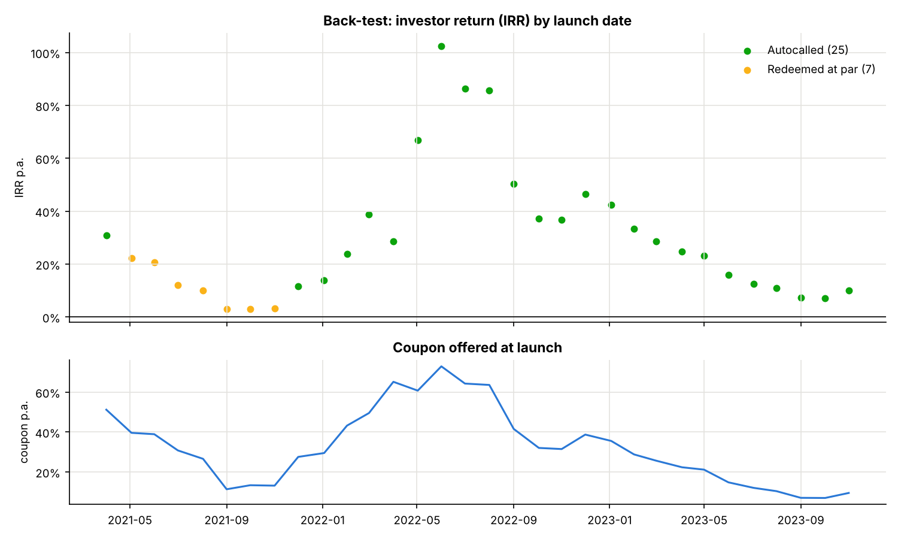

Caveat: coupons range from 7% to 73% because 2022 realised vol was huge, and the sample is small and
mostly a bull market for these stocks. It does not prove the product is "safe".

---

## 4. On the desk: hedging and daily P&L explain

**Hedge back-test.** On the same 32 notes, the desk sells the note at 95.2% and hedges every week:

| Strategy | Mean P&L | Std dev | Worst note |
|---|---|---|---|
| Unhedged | −29.2% | 22.5% | −77.8% |
| Delta (stocks) | −14.6% | 21.8% | −74.5% |
| **Delta + vega (stocks + 1y ATM calls)** | **−2.2%** | **8.5%** | **−18.7%** |

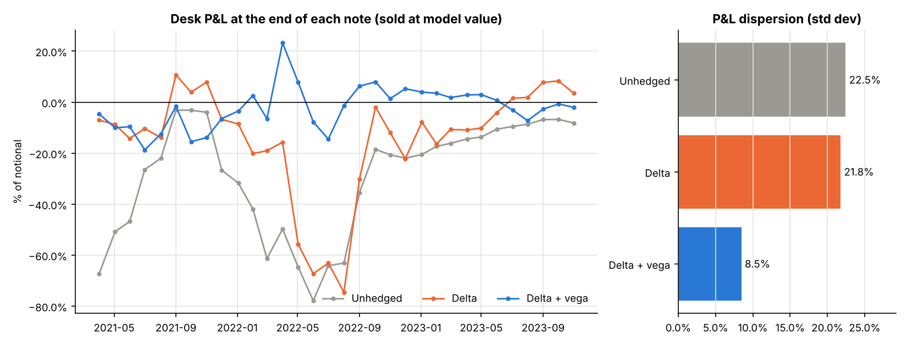

Delta alone is not enough: the desk is long vol through the note, and vol moved a lot. Adding vanilla options cuts the dispersion by ~2.6x.
The mean is negative because the coupons were solved with past vol, and these stocks rallied (most notes autocalled early).

**Daily P&L explain on the real note** (7 Nov 2025 → 29 Oct 2026). The desk is short the note and delta-hedged every day.
Each day I split its P&L with a Taylor expansion:

`P&L = gamma + cross-gamma + vega + correlation + theta + carry + residual`

| Term | Meaning | Since launch |
|---|---|---|
| Gamma | ½·Γ·ΔS², earned by re-hedging after big moves | +22.5% |
| Cross-gamma | moves of two stocks at the same time | −1.6% |
| Theta | time passing | −20.0% |
| Vega | change in vol | +1.9% |
| Correlation | change in correlation | +1.4% |
| Carry | funding of the note and the hedge | +1.4% |
| Residual | what the Greeks don't explain (jumps, higher orders) | −4.0% |
| **Desk P&L (delta-hedged)** | | **+1.6%** |
| *Desk P&L if unhedged* | | *−6.0%* |

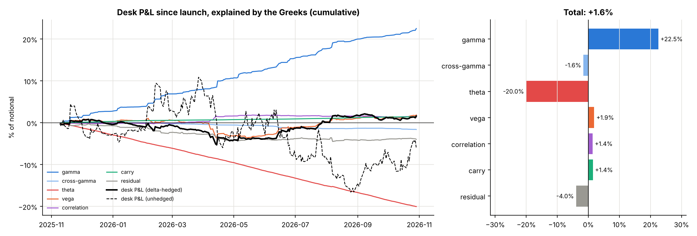

**The key trade-off of the desk:** it is long gamma (it makes money when stocks move a lot) and pays for it with theta
(it loses a bit every day). Here the two almost cancel. The residual is small compared to gamma and theta,
so the Greeks explain most of the P&L. For this part I use Black-Scholes with 1-year realised vol, which is smoother day to day.

---

The Bloomberg data is not in this repo (licensed data). `data/bloomberg/README.md` explains the file format,
so you can rebuild it from your own terminal (OVDV screen). The results in `results/` come from the real data.

---

## Files

```
autocall/
  product.py      the term sheet and the payoff on one path
  vol_surface.py  SSVI calibration and Dupire local vol
  market.py       Bloomberg data -> rates, dividends, surfaces, correlation
  monte_carlo.py  correlated paths under local vol
  pricer.py       price, coupon solver, building blocks, probabilities
  risks.py        coupon levers, vol x correlation grid, Greeks
  live_note.py    the note since launch, value today, value bridge
  backtest.py     historical back-test for the investor
  hedging.py      hedge back-test (unhedged / delta / delta + vega)
  pnl_explain.py  daily P&L explain of the desk
  plots.py        all charts
run_analysis.py   runs everything
termsheets/       Barclays pricing supplement
```
